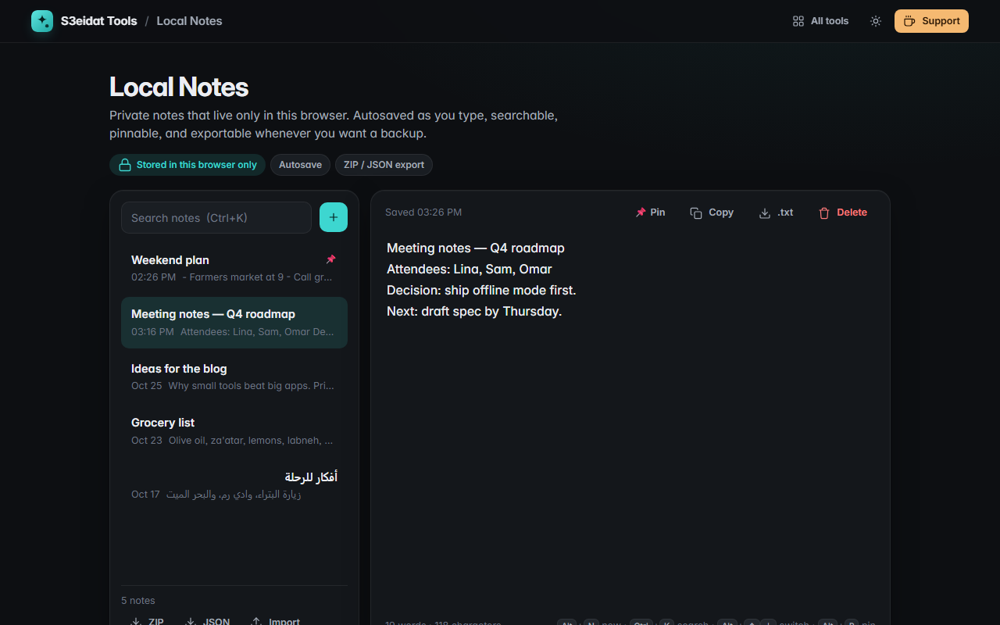

# Local Notes

> Private notes that live only in your browser. Free, private, and it runs entirely in your browser.

### ▶ [Open Local Notes](https://s3eidat.github.io/local-notes/)



## Features

- As many notes as you like; the **first line is the title**
- **Autosave** as you type (and stays in sync if you have the page open in two tabs)
- **Search** across all notes (every word must match)
- **Pin** important notes to the top
- **Delete with undo**
- **Word count**, character count and reading time
- Export **all notes as a .zip of .txt files**, a single note as **.txt**, or a **JSON backup**
- **Import** a JSON backup (validated; duplicates are skipped)
- Keyboard shortcuts: <kbd>Alt</kbd>+<kbd>N</kbd> new, <kbd>Ctrl</kbd>+<kbd>K</kbd> search, <kbd>Alt</kbd>+<kbd>↑</kbd>/<kbd>↓</kbd> switch notes, <kbd>Alt</kbd>+<kbd>P</kbd> pin, <kbd>Ctrl</kbd>+<kbd>S</kbd> save now
- Works with Arabic and other right-to-left text

## Privacy

Your notes never leave your device. They are stored in your browser's localStorage, with no server, no account
and no analytics. The page ships with a strict Content-Security-Policy (`connect-src 'self'`), so the browser
itself blocks any attempt to send data anywhere. Clearing your browser data deletes the notes, so export a backup now and then.

## Run it yourself

It's plain HTML, CSS and JavaScript with no build step:

```bash
git clone https://github.com/s3eidat/local-notes
cd local-notes
python -m http.server 8000
```

Then open http://localhost:8000.

## Support

If this saved you time, **[buy me a coffee ☕](https://s3eidat.github.io/coffee/)**. It keeps every tool free.

---

Part of **[S3eidat Tools](https://s3eidat.github.io/)**: 100+ free, private tools that run in your browser. MIT licensed.
